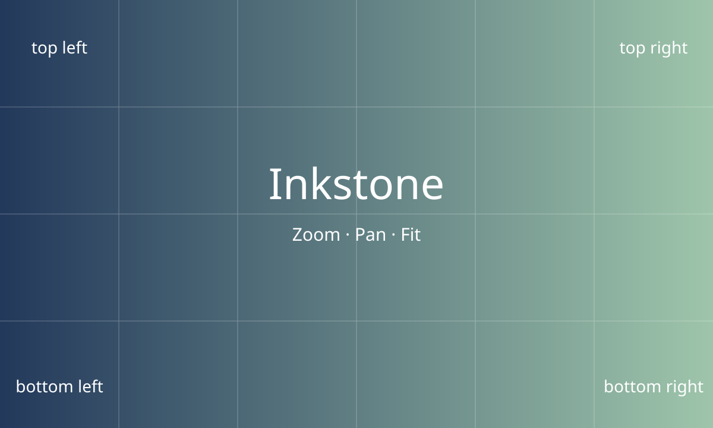

# Inkstone: rich views

Normal text. <small>Small note.</small>

## Table / list / chart

Put the cursor in this table and run `:Inkstone toggle_view` (or press Enter in
`:Inkstone preview`). Repeat to cycle table → list → chart → table.

| Workload | Before | After |
| --- | ---: | ---: |
| Long inline paragraph | 151ms | 120ms |
| Japanese table | 27ms | 19ms |
| Unchanged decoration refresh | 5.34ms | 1.09ms |

Separate two-way switches are `:Inkstone toggle_list` and `:Inkstone toggle_chart`.

## Image viewport

Place the cursor at the image and run `:Inkstone media`. Use `+` / `-` to zoom,
`hjkl` to pan, `0` to fit and `q` to close. A linked PDF uses `[` / `]` for pages.

Source remains intact

The same view action toggles this details block. Image, chart and typography
views do not change the Markdown used for save, yank or search.

